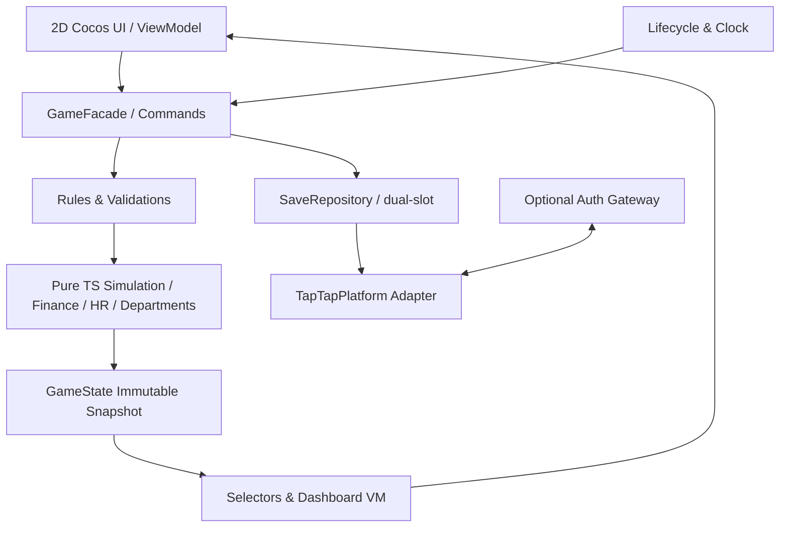

# 01｜整体架构、代码目录与模块契约

## 1.1 技术选择（建议）

- Cocos Creator **3.8.x** + TypeScript（以TapTap官方适配插件支持版本为准），2D UI体系，不做3D/物理引擎逻辑。
- 核心经营计算：**纯TypeScript、不依赖Cocos/DOM/平台SDK**。可在Node测试环境运行，便于无头模拟1万年/多组种子。
- 表现层：Cocos UI组件（Canvas、Prefab、Label、ScrollView、Button、Layout、Sprite等），只读取ViewModel并派发Command。
- 平台层：`ITapPlatform`抽象，编辑器Mock和TapTap真实实现；所有`tap.*`调用集中在`platform/taptap`。
- 数据：一个活动经营run，业务本地存档；轻量服务端只为平台认证验证（如发布实际接入要求），不保存经营账本。
- 配置：本地JSON/TS资源，版本化并带哈希；无远程随意改变数值。

## 1.2 分层和数据流



**禁止**UI手写计算利润、直接增减钱、直接创建员工并绕过命令层；所有变动通过命令+领域状态改变，返回明确结果。

## 1.3 建议工程目录（真实新建时以此为默认）

```text
im-ceo/
  assets/
    scenes/Boot.scene, Game.scene
    prefabs/{Header,BottomTabs,MetricCard,EmployeeCard,DeptCard,Dialog,Hint}.prefab
    scripts/ui/{BootView,CompanyView,DeptView,TalentView,RankView,ModalRouter,TutorialOverlay}.ts
    scripts/ui/vm/{companyVM,departmentVM,talentVM,rankVM}.ts
    resources/config/economy.v1.json
    resources/ui/                # 图标和必要字体；所有动态文字运行时渲染
  src/
    domain/{types,errors,commands,queries,company,ceo,employee,department,finance,market,events}.ts
    simulation/{gameClock,monthlyStep,annualClose,offlineSettlement,rng,rounding}.ts
    automation/{staffingPolicy,autoHire,budgetGuard,recommendations}.ts
    persistence/{SaveRepository,SaveCodec,SaveMigration,Checksum,ResetGuard}.ts
    platform/{ITapPlatform,EditorMockPlatform,TapMiniGamePlatform,AuthGatewayClient}.ts
    application/{GameFacade,GameBootstrap,GameStore,viewModels}.ts
    config/{EconomyConfig,ConfigValidator}.ts
  tests/
    unit/{finance,staff,department,clock,reset,rng}.test.ts
    integration/{fiveYears,offline,restart,createCompany}.test.ts
    fixtures/golden-cases.v1.json
  tools/{validate-config,simulate-batch,generate-evidence}.ts
  docs/                             # 将本设计包复制至此
  package.json, tsconfig.json, eslint.config.js, README.md
  .github/workflows/ci.yml
```

编辑器实际要求脚本必须处于assets下时可设置TS路径别名/建立拷贝策略，但**不要复制两份独立的核心计算逻辑**；优先一个可被引擎和Node共同编译的源目录。

## 1.4 服务接口（领域层）

所有命令带`expectedRunId`、`commandId`和可选`expectedRevision`；成功返回 `{ok:true, stateRevision, payload}`，失败 `{ok:false,code,message,details}`，**失败不改变状态**。

```ts
interface GameFacade {
  bootstrap(): Promise<BootstrapResult>;
  rollCompanyNames(industry: IndustryId, count: 3): string[];
  createCompany(command: CreateCompanyCommand): Promise<Result<void>>;
  recruitInitialEmployee(candidateId: string, commandId: string): Promise<Result<Employee>>;
  getRecruitmentOffer(deptId: string): Offer;
  hireEmployee(candidateId: string, deptId: string, commandId: string): Promise<Result<Employee>>;
  getSeverancePreview(employeeId: string): SeverancePreview;
  dismissEmployee(employeeId: string, commandId: string, confirmationToken: string): Promise<Result<void>>;
  createDepartment(type: SupportDepartmentType, commandId: string): Promise<Result<Department>>;
  updateDepartmentStaffing(deptId: string, mode: 'AUTO'|'LOCKED', target: number): Promise<Result<void>>;
  setBusinessPolicy(policy: 'STEADY'|'GROWTH'|'PROFIT'): Promise<Result<void>>;
  setSpeed(speed: 0|1|2|5): Promise<Result<void>>;
  tick(realElapsedMs: number): Promise<Result<TickSummary>>;
  settleOffline(nowEpochMs: number): Promise<Result<OfflineSummary>>;
  getDashboard(): DashboardVM;
  getAnnualReport(year: number): AnnualReport|null;
  getRanking(type: 'ASSETS'|'TENURE'): RankRow[];
  beginCloseCompany(): ResetPreview;
  confirmCloseCompany(expectedRunId: string, confirmationToken: string): Promise<Result<void>>;
}
```

### 错误码

`NOT_READY`, `RUN_CHANGED`, `REVISION_CONFLICT`, `INVALID_NAME`, `INVALID_INDUSTRY`, `ONBOARDING_INCOMPLETE`, `OFFER_EXPIRED`, `INSUFFICIENT_CASH`, `DEPT_ALREADY_EXISTS`, `DEPT_NOT_FOUND`, `EMPLOYEE_NOT_FOUND`, `EMPLOYEE_NOT_DISMISSIBLE`, `CONFIRMATION_EXPIRED`, `AUTOMATION_LOCKED`, `MONTH_ALREADY_SETTLED`, `SAVE_FAILED`, `SAVE_CORRUPT`, `RESET_IN_PROGRESS`, `PLATFORM_UNAVAILABLE`, `AUTH_REQUIRED`。每个错误均有固定中文友好文案，日志仅记录错误码/运行ID，不记录玩家敏感个人信息。

## 1.5 模块依赖和实现顺序

| 模块 | 输入 | 输出 | 禁止直接依赖 |
|---|---|---|---|
| CompanyCreator | 随机名、行业、CEO、2次首聘 | 初始公司/员工/资金 | UI Prefab、tap SDK |
| CandidateGenerator | 种子、岗位、招聘轮次 | 稳定3人Offer | 实时网络、系统不受控随机 |
| StaffingService | Offer、现金、岗位 | 员工、招聘费记账 | 直接界面状态 |
| DepartmentService | 员工、业务规模、行业系数 | 部门成本/增益 | 游戏时间的真实秒数 |
| MonthlySimulator | 月开始State、Config、RNG | 月末State+Ledger+Event | 文件系统、UI |
| AnnualClose | 12月Ledger | 年报和盈利连续年数 | 人物头像资源 |
| OfflineService | lastAt、now、上限、状态 | 离线月份、摘要 | 浏览器localStorage |
| RankingService | 年末资产与年限、BotSeed | 排名表 | 在线排行 SDK |
| SaveRepository | serializableState | 完整性校验后的slot/指针 | 游戏经济公式 |
| TapMiniGamePlatform | 必要Tap接口 | 生命周期、窗口、读写、认证桥接 | 业务规则 |

## 1.6 状态变更过程

1. UI点击→生成唯一`commandId`（同一点击防抖仍需防重复命令）→Facade校验。
2. 领域函数对状态生成候选新快照和财务分录；校验所有不变量。
3. SaveRepository先写快照候选槽，再写活动指针；成功才反馈“操作已保存”。
4. 若持久化失败，保持原运行状态/回滚至上一个提交快照；不能UI显示录用成功但重启消失。
5. 广播`GameStateChanged`，Selector派生VM，刷新相关卡片；更新不在组件内自行计算。

> 存储提交顺序和重置墓碑详见02；模拟流中的每个内部月也视为事务。低端设备可将多个模拟月分块执行，避免主线程卡顿，但不得跳过财务账。

## 1.7 配置/构建/代码质量

- 包管理Node LTS（具体版本由项目实际CI锁定）、严格TS (`strict`, `noUncheckedIndexedAccess`)，禁止`any`渗透领域层。
- 日志等级：DEBUG仅开发，INFO记录运行状态和结果摘要，ERROR记录非敏感故障；正式发布禁止打印敏感凭证。
- 仓库提交遵循`feat(M1): ...`；提交前须`typecheck`、`lint`、`unit`、`golden`通过。
- 每个M里程碑：Cocos编辑器能进入、核心状态可视化且可录屏；不仅是Node控制台逻辑。
- 不依赖在线配置保证基础可玩；断网仍保留本地经营（平台首次认证可能按官方要求受限，见08）。

## 1.8 埋点与性能（MVP仅本地调试）

最低事件：`game_created`, `onboarding_step`, `hire_confirmed`, `hire_rejected`, `dept_created`, `year_closed`, `cash_risk`, `game_reset`, `offline_settled`, `save_error`。默认只输出本地开发日志；**不在无隐私告知情况下偷偷上传分析数据**。

参考性能预算（目标，不是平台硬指标）：普通界面点击反馈<150ms；年度结算主线程任务分块；首次可交互<5秒（真实设备调优）；正常内存不持续增长；存档<500KB（单键密封加密时上限更紧）；经100次重开及3年离线模拟无内存泄露。
